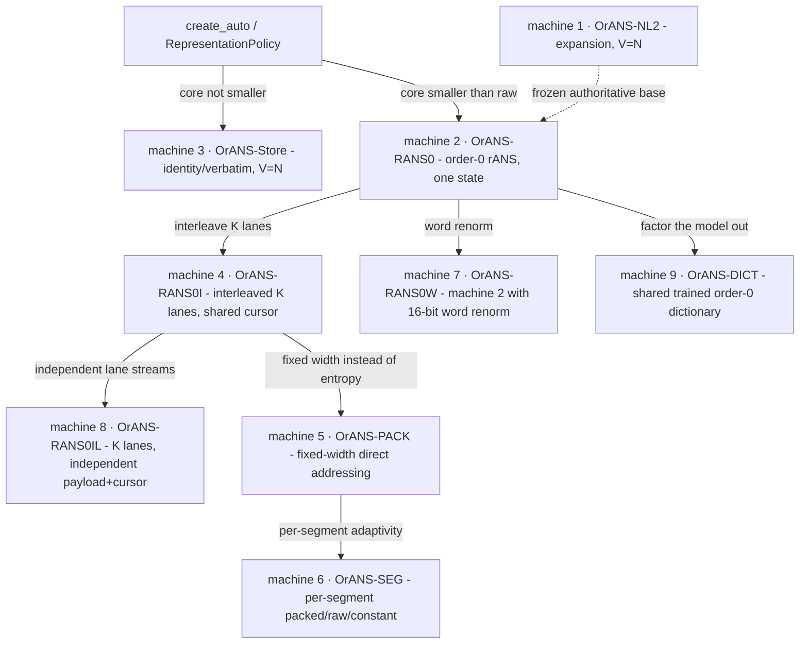

# EKBLOOM — the machine catalogue (ids 1–9)

**Scope.** This is the single reference for every *machine* EKBLOOM implements: what
each one is, its exact transition/encoding mathematics, its complete resumable state,
a decode algorithm sufficient to reimplement it, its size, and where it wins or loses.
It complements — and does not replace — [`CODEC.md`](CODEC.md) (the machine-2/3/4
contract), [`CORE-LAYOUT.md`](CORE-LAYOUT.md) (byte-exact wire layout),
[`DESIGN.md`](DESIGN.md) §1 (the frozen machine-1 contract),
[`PACKED_MACHINE.md`](PACKED_MACHINE.md) (machine 5),
[`SEGMENTS.md`](SEGMENTS.md) (machine 6),
[`DICTIONARY.md`](DICTIONARY.md) (machine 9),
[`DECODERS.md`](DECODERS.md) (machines 7/8 keep-reject),
[`MIGRATION.md`](MIGRATION.md) (versioning) and
[`BUDGET-GUIDE.md`](BUDGET-GUIDE.md) (how to choose).

A machine is a reproducible, resumable symbol generator: `encode(source) -> core`
produces the visible core; `reveal(core, &mut Omega) -> symbol` advances the complete
resumable state `Omega`. Semantics are frozen per `machine_id` (see
[`MIGRATION.md`](MIGRATION.md)): changing any transition or `S(v)` requires a **new
`machine_id`**, never an in-place edit.

---

## 0. Relationship map



**Registry** (`src/machine.rs`). Every machine writes `core_version =
CORE_VERSION_CURRENT = 1` and reads `{0 (legacy/implicit), 1}`; the version lives in
the `.ekb` genesis header, not the core, so every `encode` output is byte-identical to
pre-`core_version` releases ([`CODEC.md`](CODEC.md) §"Explicit core versions",
[`CORE-LAYOUT.md`](CORE-LAYOUT.md) §1.3).

| id | name | module | header bytes | `V` (core bytes) | cursor = position? | chosen by `Auto`? |
|---:|---|---|---:|---|:--:|:--:|
| 1 | `OrANS-NL2` | `machine.rs` | 0 | `N` | yes (`p_i=i`) | fallback base[^a] |
| 2 | `OrANS-RANS0` | `machine_rans.rs` | 516 | `516 + R` | **no** | **yes** (compressing) |
| 3 | `OrANS-Store` | `machine_store.rs` | 0 | `N` | yes | **yes** (verbatim base) |
| 4 | `OrANS-RANS0I` | `machine_rans_i.rs` | `516 + 4K` | `516 + 4K + R` | **no** | no (explicit) |
| 5 | `OrANS-PACK` | `machine_pack.rs` | `10 + k` | `10 + k + ceil(N·bits/8)` | yes | no (`Packed`) |
| 6 | `OrANS-SEG` | `machine_seg.rs` | `96` + directory | `96 + directory + payloads` | yes | no (`Segmented`) |
| 7 | `OrANS-RANS0W` | `machine_rans_w.rs` | 516 | `516 + 2·W` | **no** | no (explicit) |
| 8 | `OrANS-RANS0IL` | `machine_rans_il.rs` | `516 + 8K` | `516 + 8K + Σ lane_len` | **no** | no (explicit) |
| 9 | `OrANS-DICT` | `machine_dict.rs` | `20` (+dict) | `20 + dict_len + 8 + R` | **no** | no (explicit) |

[^a]: `create_auto` tries machine 2 first; machine 1 is the frozen authoritative machine
and the default only where an explicit id `1` is requested. The `auto` policy falls back
to machine 3, never machine 1, when order-0 rANS does not shrink the source.

Two structural axes separate the machines: **whether the cursor equals the logical
position** (a *position-addressable* machine, where `Snapshot::new(state, i)` is a
complete resumable state and `skip` is `O(1)`) or **diverges** (a *cursor-divergent*
rANS machine, where only complete checkpoint/block states restart, and a read is
served from a bounded encoded window). Machine 1/3/5/6 are position-addressable;
machine 2/4/7/8/9 are cursor-divergent.

---

## 1. Machine 1 — `OrANS-NL2` (`machine_id = 1`)

*The authoritative expansion machine; the frozen §1 contract.*
Notation: `x` is 16 bits, `h = x >> 8`, `l = x & 0xFF`. `S` is a fixed byte
permutation, `S(v) = v ^ (v << 1) ^ (v << 3)` (all masked to 8 bits).

**Purpose.** Reveal `n = logical_len` symbols from an `n`-byte core, exactly and
invertibly, with one core byte consumed per revealed symbol (`V = N`). It is the basis
of the affine/prefix and packed-`u16` properties (P11, P12).

**Mathematics.** `S` is **linear over GF(2)^8** (multiplication by the polynomial
`1 + x + x^3`) and therefore **bijective**: `S(a ^ b) = S(a) ^ S(b)` and no two bytes
collide (`sbox_is_bijective`, `src/machine.rs`). Genesis `Omega_0 = (x=0, p=0)`.

Encode (`core = encode(source)`):

```text
x = 0
for i in 0..n:
    h = x >> 8;  l = x & 0xFF
    core[i] = source[i] ^ S[h] ^ l
    x = (l << 8) | source[i]           # state-log update G(x, s)
```

Reveal (one step at position `i`, `p == i`):

```text
h = x >> 8;  l = x & 0xFF
s = S[h] ^ l ^ core[i]
x' = (l << 8) | s
```

**State log identity.** The state depends only on the symbol sequence:
`Log[0] = 0`, `Log[i+1] = ((Log[i] & 0xFF) << 8) | s_i`, hence
`x_i = (s_{i-2} << 8) | s_{i-1}` for `i >= 2` (`x_0 = 0`, `x_1 = s_0`). Invertibility
follows: `s_i = x_{i+1} & 0xFF`.

**Complete resumable state.** `Omega_i = (x_i, p_i)` with `p_i = i` (12 packed bytes:
`u32` state ++ `u64` cursor). A restart at `i` resumes directly; no replay is needed.

**Decode algorithm.** `x = 0; for i in 0..n { h = x>>8; l = x&0xFF; s = S[h]^l^core[i];
out[i] = s; x = (l<<8)|s }`.

**Size.** `V = N` exactly, header 0 bytes (measured `V/N = 1.0000`; base/raw for the
frozen machine, [`CODEC.md`](CODEC.md) §"auto").

**Wins / loses.** Wins: no model header, exact per-position state (packed restarts are
1/6 the bytes, [`PACKED_MACHINE.md`](PACKED_MACHINE.md), P12). Loses: it never
compresses (`V = N`); against order-0 rANS on skewed data it stores ≈`1/0.198` ≈ **5×
more** ([`CODEC.md`](CODEC.md)). As the base for `auto` it is superseded by machine 2/3.

---

## 2. Machine 2 — `OrANS-RANS0` (`machine_id = 2`)

*Order-0 byte range-ANS; the first compressing machine (`V < N` on skewed data).*

**Purpose.** Store a *skewed* source in fewer bytes than raw by entropy-coding with a
model learned from the source itself.

**Core layout.**

```text
[freq: 256 * u16 LE = 512 B][initial_state: u32 LE][renorm bytes, reverse emission order]
```

`SCALE_BITS = 12`, `M = 4096`, `RANS_L = 1 << 23`, `HEADER_BYTES = 516`. `freq[s] >= 1`
and `Σ freq = 4096`; `cum` is the derived prefix sum.

**Model.** `count[s]` = source byte counts, `clamped[s] = max(count[s],1)`. Reserve 1
per symbol, distribute the remaining `budget = M - 256 = 3840` by **largest-remainder**
(floor + one unit to the largest fractional parts, ties by symbol index);
`freq[s] = 1 + distributed[s]`. The empty source gives every `freq = 16`.

**Encoder** (symbols in reverse):

```text
x = RANS_L
for s in source.rev():
    f = freq[s]; c = cum[s]
    x_max = ((RANS_L >> 12) << 8) * f
    while x >= x_max { emit(x & 0xFF); x >>= 8 }
    x = ((x / f) << 12) + (x % f) + c
emit_final(x)                              # initial_state
```

**Decode step** (`reveal`):

```text
slot = x & 4095
s    = symbol_table[slot]                  # unique s with cum[s] <= slot < cum[s]+freq[s]
x    = freq[s] * (x >> 12) + slot - cum[s]
while x < RANS_L { x = (x << 8) | next_core_byte() }
```

**Complete resumable state.** `Omega = (x, cursor)`; genesis
`(initial_state, HEADER_BYTES)`. The cursor is a byte offset into `core` and **diverges
from the logical position**, so `(state, cursor)` alone does not decode the next symbol
without the cursor; checkpoint sets carry the true cursor and the file reader serves
cursor-divergent reads from a **bounded encoded window** (`≤ 2·(steps+symbols)+64` bytes,
[`WINDOW.md`](WINDOW.md), P35). `check_core` dry-runs the declared symbol count under a
step cap so a crafted non-renormalising stream is `NonTermination`.

**Size.** `V = 516 + R`. Measured `V/N = 0.511` on skewed (8,371 B for 16 KiB) and
`1.015` on uniform (order-0 cannot compress random bytes; only the header costs),
[`CODEC.md`](CODEC.md) §"Measured space".

**Wins / loses.** Wins: a real space win on skewed data and the `auto` default there
(`V/N = 0.198` on the 4 MiB skewed frontier). Loses: no win on uniform data (costs the
516-byte header) and a serial decode chain behind interleaved machine 4
([`CODEC.md`](CODEC.md), P10, P23).

---

## 3. Machine 3 — `OrANS-Store` (`machine_id = 3`)

*The identity / verbatim codec; the `auto` footprint floor.*

**Purpose.** Guarantee the base representation is never larger than raw: when order-0
rANS cannot shrink the source, store the source itself.

**Encoding / decode.** `core = source` (a verbatim copy). Genesis `(0, 0)`. One step
`reveal` returns `core[cursor]`, sets `state = u32::from(symbol)`, and advances the
cursor by one. `check_core` requires `logical_len <= core.len()`.

**Complete resumable state.** `Omega_i = (state = s_{i-1}, cursor = i)`; cursor equals
the logical position, so `Snapshot::new(state, i)` is exact and `skip` is `O(1)`.

**Size.** `V = N` exactly, header 0 bytes. Measured base/raw = `1.0000` on uniform
([`CODEC.md`](CODEC.md) §"auto"; `frontier.json`).

**Wins / loses.** Wins: never expands past raw (P24), and the position-addressable
identity makes checkpoints/tiles/blooms/blocks all apply through the machine-general
paths (a bare machine-3 core is itself a certified `O(1)` bounded path,
`StructureRef::Core`). Loses: no compression at all on uniform data, where a
whole-object body can still exceed raw once structures are added
([`FRONTIER.md`](FRONTIER.md), limitation 12).

---

## 4. Machine 4 — `OrANS-RANS0I` (`machine_id = 4`)

*Interleaved order-0 rANS: machine 2's model and `V`, with `K` independent lane states
sharing one renorm cursor.*

**Purpose.** Break machine 2's serial dependent decode chain so decode throughput
escapes it (the best scalar decoder; `K = 8`).

**Core layout.**

```text
[freq: 256 * u16 LE = 512 B][K: u32 LE][K initial states: K * u32 LE][interleaved renorm bytes, reversed]
```

`K ∈ [1, 8]`; the model is byte-for-byte machine 2's (`M = 1<<12`, `RANS_L = 1<<23`,
same largest-remainder scaling). Symbol `i` is coded in lane `i % K`.

**Encoder** (`encode_with_k`): walk symbols in reverse; for lane `i % K`, apply machine
2's byte-renorm step to that lane's state and append emitted bytes to one shared stream,
stored reversed.

**Decode step** (lane `= cursor_lane`):

```text
slot = lanes[lane] & 4095
e    = table[slot]                                  # fused (freq, cum, symbol)
nx   = (lanes[lane] >> 12) * freq + slot - cum
while nx < RANS_L { nx = (nx << 8) | next_shared_byte() }
lanes[lane] = nx;  lane = (lane + 1) % K;  symbol = e.symbol
```

**Complete resumable state.** `Omega = (lanes: [u32; K], cursor, lane)`. Because the
compact `(state, cursor)` projection is lossy for lanes, restarts are stored in the
**wide** `Snapshot` form (`Snapshot::WIDE_LEN = 4 + 8 + 1 + 4·MAX_LANES = 45` B, with
`MAX_LANES = 8`); `verify` re-checks the lanes (P29).

**Size.** `V = 516 + 4K + R`. Measured `K = 8`: 829,939 B vs machine 2's 829,911 B on
4 MiB skewed (`frontier.json`, `decoders.json`); decode ≈**2.09–2.28 ns/byte**
(≈**1.60×** machine 2).

**Wins / loses.** Wins: the best scalar decode rate and best EKBLOOM cold 4 KiB p50
(≈**9.0–9.3 µs** skewed, 45-byte restart), narrowing but not closing the LZ4 gap
([`DECODERS.md`](DECODERS.md), P25, P29; limitation 14). Loses: not selected by `Auto`
(its core is machine 2's plus `4 + 4K` bytes); cold still ≈**4.3×** slower than
block-indexed LZ4 while storing ≈**3.2×** less.

---

## 5. Machine 5 — `OrANS-PACK` (`machine_id = 5`)

*Directly-addressable fixed-width packing: each symbol is a `bits`-wide index into the
source alphabet, so any position is an `O(1)` shift/mask.*

**Purpose.** Trade entropy coding for constant-time positional access with no replay.

**Core layout.**

```text
[bits: u8][k: u8][alphabet: k bytes][logical_len: u64 LE][payload: ceil(N·bits/8) bytes]
```

`bits ∈ [1,8]`; `k` is the alphabet size, `0` for the **identity alphabet** (all 256
values present, no alphabet bytes, `symbol = index`); the alphabet is the `k` distinct
symbols ascending. Two special renderings: **constant** (`k = 1`, one alphabet byte,
**zero payload**) and **identity** (`bits = 8, k = 0`, payload `= source`), returned
whenever packing would not beat raw, so a machine-5 core is **never larger than
raw + 10 bytes**.

**Extraction (the `O(1)` step)** for position `i`:

```text
bit = i * bits;  byte = bit >> 3;  off = bit & 7
idx = (payload[byte] >> off) & mask                    # one byte if off+bits <= 8
    = ((payload[byte] >> off) | (payload[byte+1] << (8-off))) & mask   # else
symbol = if k == 0 { idx } else { alphabet[idx] }
```

**Complete resumable state.** `Omega = (state = last revealed symbol, cursor = i)`;
cursor equals position, so `Snapshot::new(state, i)` is exact and `skip` is `O(1)`.

**Size.** `10 + k + ceil(N·bits/8)`. On the 4-symbol skewed source (`bits = 2`) the
measured core is **1,048,590 B** (`N/4` + 14-byte header), vs machine 2's **829,911 B**.

**Wins / loses.** Wins: `O(1)` positions with no index — 1-byte p50 ≈**30 ns**
(raw-index parity), 4 KiB ≈**3.5 µs** vs machine 2 ≈**13.5 µs**, bulk ≈**1.16 GB/s**
vs 0.30–0.44 ([`PACKED_MACHINE.md`](PACKED_MACHINE.md), P36). Loses: on low-entropy data
fixed 2 bits/symbol is **larger** than order-0 ≈1.49 bits/symbol; it does not beat raw
`memcpy` or indexed LZ4 on raw speed; on uniform data it is the identity fallback
(`N + 10` B). Explicit, non-default (`RepresentationPolicy::Packed`).

---

## 6. Machine 6 — `OrANS-SEG` (`machine_id = 6`)

*Versioned segmented container: each logical segment chooses its own
directly-addressable representation (packed / raw / constant).*

**Purpose.** Adapt the physical representation to *local* statistics — the
heterogeneous-object case that whole-object order-0 rANS and fixed packing both handle
badly.

**Core layout.**

```text
core = [magic "ESEG"/version header (96 B)][directory][segment payloads]
```

Header fields: `magic "ESEG"`, `version = 1`, `flags` (bit 0 = variable directory),
`segment_count`, `entry_bytes = 56`, `seg_shift`, `window_shift`, `logical_len`,
`directory_bytes`, `payload_offset`, `payload_bytes`, `directory_hash` (BLAKE3 over the
directory **and** the payloads). Each 56-byte directory entry binds
`(logical_start, logical_len, physical_offset, physical_len, machine_id, model_ref,
content_id)`; `machine_id` is the per-segment encoder: `0` constant (one payload byte),
`3` raw (verbatim), or `5` packed. `model_ref = SEG_NO_MODEL` (stateful machines with a
segment-start restart are a documented future extension, excluded so every position is
`O(1)`).

**Locating a segment.** Fixed mode: `offset >> seg_shift` (a shift, no division/search);
variable mode: a level-1 window index (`(first_segment, count)` per
`1 << window_shift`) then a bounded scan of that window's level-2 entries.

**Complete resumable state.** `Omega = (state, cursor = i)`; cursor equals position, so
`Snapshot::new(state, i)` is exact and `skip` is `O(1)`.

**Size.** `96 + directory_bytes + payload_bytes`. Measured (4 KiB segments, 1024
segments; `frontier.json`): `skewed` **1,120,352 B**; `mixed` **2,686,048 B**;
`uniform` **4,251,744 B**.

**Wins / loses.** Wins: `mixed` **2,686,048 B = −10.1 %** vs machine 2 (2,986,989 B),
within **2.5 %** of the 2,621,440 B oracle including all metadata; `O(1)` index-free
1-byte reads (≈40 ns) and memcpy-speed 4 KiB reads on the raw half
([`SEGMENTS.md`](SEGMENTS.md), P37). Loses: pure `skewed` (1,120,352 B > machine 2's
829,911 B) and pure `uniform` (raw + 57,440 B directory tax); packed-range throughput is
the 2-bit unpack, not a copy. Explicit, non-default (`RepresentationPolicy::Segmented`).

---

## 7. Machine 7 — `OrANS-RANS0W` (`machine_id = 7`)

*machine 2 with 16-bit word renormalisation: at most one renorm read per step.*

**Purpose.** A decode-throughput variant — same model, same `V`, cheaper renorm shape.

**Core layout.**

```text
[freq: 256 * u16 LE = 512 B][initial_state: u32 LE][renorm words: u16 LE, reversed]
```

`RANS_W_L = 1 << 15`; a genuine encoder keeps every state in
`[RANS_W_L, RANS_W_L << 16)`, which fits a `u32`.

**Decode step.** Identical to machine 2 except the renorm shifts a **16-bit word**:

```text
slot = x & 4095;  s = table[slot].symbol
nx = freq[s] * (x >> 12) + slot - cum[s]
if nx < RANS_W_L { nx = (nx << 16) | next_core_u16() }     # at most one iteration
```

**Bound argument.** The pre-renorm successor is `nx >= RANS_W_L >> 12 = 2^3`, so one
16-bit read gives `nx << 16 >= 2^19 > RANS_W_L`; the encoded-window **byte** bound is the
same `2·(steps+symbols)+64` as machine 2 with half the renorm iterations
(`RENORM_MAX_BYTES_PER_STEP_W = 2`).

**Complete resumable state.** `Omega = (state, cursor)`; the ordinary pair, so blocks and
checkpoints use the compact **12-byte** form.

**Size.** `V = 516 + 2·W`; essentially machine 2's core for the same source
(829,880 B vs 829,911 B skewed in [`DECODERS.md`](DECODERS.md)).

**Wins / loses.** Wins: ≈**6 %** faster than its own baseline machine 2 and the cheapest
encode (≈17.1 ms) with a 12-byte restart. Loses: still a **single serial state chain** —
≈**37 %** slower than machine 4 `K = 8`, so it is kept as a versioned machine but is
**not** the default ([`DECODERS.md`](DECODERS.md), P41).

---

## 8. Machine 8 — `OrANS-RANS0IL` (`machine_id = 8`)

*Independent-lane streams: machine 4's `K` states, but each lane owns its own payload
range and cursor.*

**Purpose.** Remove the shared-cursor ordering so lanes are fully independent (usable
for a future parallel reconstructor).

**Core layout.**

```text
[freq: 256 * u16 LE = 512 B][K: u32 LE][lane_len[0..K]: K*u32 LE][states[0..K]: K*u32 LE]
[lane 0 payload][lane 1 payload]...[lane K-1 payload]      # each lane stored reversed
```

Symbol `i` is coded in lane `i % K`; lane `t`'s payload begins at
`header_bytes + Σ lane_len[0..t]`, and `Σ lane_len == core_len - header_bytes` exactly.

**Decode step.** Machine 2's step, but reading renorm bytes from **that lane's own
cursor**; then the lane index advances cyclically.

**Complete resumable state.** `Omega = (states[K], cursors[K], lane)`, exposed as
`IlState` and packed as `K·u32 ++ K·u64 ++ u8` (`IL_STATE_LEN`). Because the generic wide
records carry machine 4's shared-cursor form and not per-lane cursors, the
`snapshot_needs_lane_cursors` capability makes those builders return a clean `Err` for
machine 8 rather than silently drop its cursors.

**Size.** `V = 516 + 8K + Σ lane_len`; ≈829,971 B on skewed (a few tens of bytes over
machine 4's 829,939 B).

**Wins / loses.** Wins: genuinely independent per-lane decode (a real structural
property). Loses: per-lane payload-range bookkeeping costs more than the ordering it
removes — ≈**+30 %** vs machine 4 `K = 8` (and worse at `K = 4`), so it is **rejected**
as a default and kept as machine 8 ([`DECODERS.md`](DECODERS.md), P41).

---

## 9. Machine 9 — `OrANS-DICT` (`machine_id = 9`)

*The `.ekb` bridge for a shared trained order-0 dictionary.*

**Purpose.** Amortise machine 2's 516-byte per-core model header across **many small
records** that share one trained dictionary.

**The dictionary** (`src/dictionary.rs`). One order-0 byte model — 256 LE `u16`
frequencies `>= 1`, summing to `M = 4096` — trained by the same largest-remainder
scaling machine 2 uses, with a 16-byte content id
`blake3("ekbloom.dictionary-id.v1" ++ version ++ freq)[0..16]`.
`to_bytes()` = 540 bytes: `[magic "EKBDICT\0":8][version u16][reserved u16][id:16][freq:256*u16]`.

**Per-record core (header-less).** `Dictionary::encode(record)` produces
`[logical_len: u32][initial_state: u32][renorm bytes, reversed]` — no model header.

**Machine-9 core (`core = encode(source)`).**

```text
[dict_id: 16][dict_len: u32 LE]
[dict_bytes: dict_len]                       # present iff dict_len > 0 (embedded)
[logical_len: u32 LE][initial_state: u32 LE][renorm bytes, reversed]
```

`dict_len == 0` **references** `dict_id` (resolved from the process-wide registry via
`dictionary::register`; an unregistered id is a typed `Err`). `dict_len > 0` **embeds** a
serialized dictionary, validated against the framing `dict_id` by recomputing the content
id, so a tampered/relabelled dictionary is refused.

**Complete resumable state.** `Omega = (initial_state, record_offset + 8)`; the cursor
**diverges** from position (as machine 2), so a read replays from genesis through the
prepared `DictContext`. The step is machine 2's prepared step exactly — the shared model
drives the same fused `slot -> (freq, cum, symbol)` table.

**Size.** Per record `20 + dict_len + 8 + R` (referenced: `20 + 8 + R`; the 540-byte
dictionary is amortised). Measured on 4,096 records of ≈100 bytes: **341,947 B total =
83.5 B/record**, vs machine 2 order-0 at **590.0 B/record**;

**Wins / loses.** Wins: ≈**7.1×** smaller and ≈**1.9×** faster per record than
per-record machine 2; break-even at **2 records** ([`DICTIONARY.md`](DICTIONARY.md),
`evidence/bench/dictionary.json`). Loses: zstd-with-trained-dictionary is still smaller
(65.9 vs 83.5 B/record) and faster (311 vs 721 ns); on *heterogeneous* records the shared
model **loses from ≈1 KiB/record onward** (crossing between 256 B and 1 KiB). Explicit,
non-default. `core_version` follows [`CORE-LAYOUT.md`](CORE-LAYOUT.md).

---

## 10. Cross-machine summary

| id | `V/N` (uniform) | `V/N` (skewed) | 1-byte p50 | cold 4 KiB | bulk | position-addressable |
|---:|---:|---:|---:|---:|---:|:--:|
| 1 NL2 | 1.000 | 1.000 | replay-bound | replay-bound | ≈0.63 GB/s | yes |
| 2 RANS0 | ≈1.015 | ≈0.198–0.511 | ≈6.5 µs | ≈13.5 µs | ≈0.30 GB/s | no |
| 3 Store | 1.000 | 1.000 | ≈30 ns (index) | ≈80 ns (memcpy) | raw-like | yes |
| 4 RANS0I | ≈1.015 | ≈0.198 | ≈4.0 µs | ≈9.0–9.3 µs | ≈0.44–0.48 GB/s | no |
| 5 PACK | `N+10` (identity) | `N/4` (4 sym) | ≈30 ns | ≈3.5 µs | ≈1.16 GB/s | yes |
| 6 SEG | `N+57,440` | 1,120,352 B | ≈40 ns | ≈3.9 µs | ≈1.0–2.0 GB/s | yes |
| 7 RANS0W | ≈1.015 | ≈0.198 | ≈13.1 µs | ≈13.1 µs | ≈0.32 GB/s | no |
| 8 RANS0IL | ≈1.015 | ≈0.198 | ≈12.1 µs | ≈12.1 µs | ≈0.34 GB/s | no |
| 9 DICT | n/a (records) | ≈0.835/record | 721 ns/record | — | ≈0.30 GB/s | no |

Numbers are the committed measurements summarised in the linked docs; see each section
for the exact source (`evidence/bench/frontier.json`, `decoders.json`, `dictionary.json`,
`rans.json`, `CODEC.md`, `DECODERS.md`). LZ4 (block-indexed) decodes a cold 4 KiB block in
≈**2.0 µs** while EKBLOOM's best (machine 4) is ≈**9.0 µs** (≈4.3×) at ≈**3.2×** less
storage — the central honest tradeoff ([`DECODERS.md`](DECODERS.md), limitation 14).

## 11. Reproduce

```sh
sh scripts/container-verify.sh   # fmt + clippy(-D warnings) + full suite
sh scripts/run-frontier.sh       # frontier.json + decoders.json
sh scripts/run-dictionary.sh     # dictionary.json
sh scripts/run-rans.sh           # rans.json
sh scripts/run-bound.sh          # bound.json (worst-case step bound)
```
